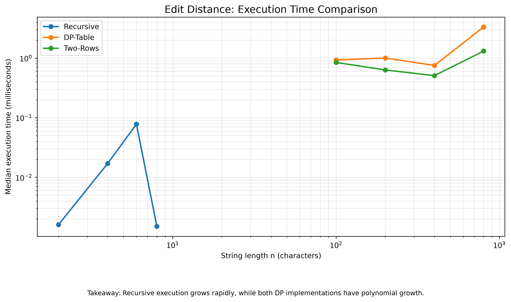
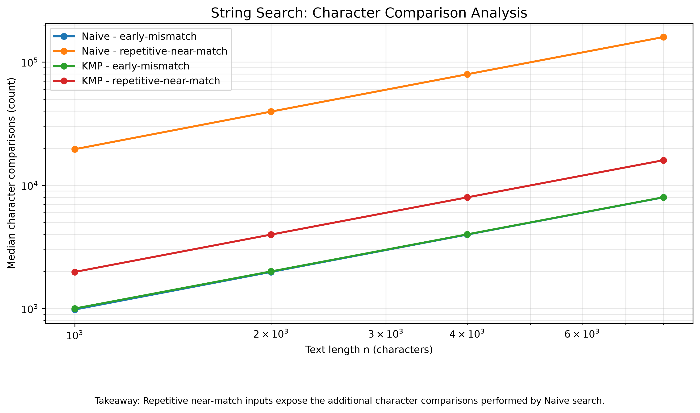
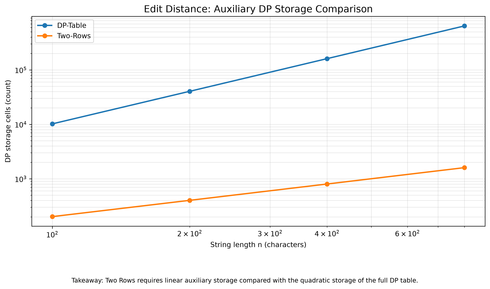

# Design and Analysis of Algorithms
## Assignment 4 – Dynamic Programming and String Algorithms

**Student:** Suyash Arora  
**Course:** Design and Analysis of Algorithms  
**Topic:** Edit Distance and String Matching

---

# 1. Experiment Design Card

## 1.1 Edit Distance

**Question:** How do recursive, DP table and two-row implementations differ in execution time, computational work and memory requirements?

**Sizes:**
- Recursive: 2, 4, 6, 8 characters.
- DP Table: 100, 200, 400, 800 characters.
- Two Rows: 100, 200, 400, 800 characters.

**Inputs:**
1. Random strings generated using a fixed seed.
2. Mismatch-heavy strings consisting of repeated A characters in the first string and repeated B characters in the second string.

**Metrics:**
- Recursive calls.
- DP cells computed.
- Execution time in milliseconds.
- Median execution time across three runs.
- Theoretical DP storage cells.

**Prediction:** Recursive execution will grow rapidly because it repeatedly solves overlapping subproblems. Both iterative implementations should have quadratic time complexity. The two-row implementation should significantly reduce auxiliary memory.

## 1.2 String Searching

**Question:** How do Naive and KMP compare in character comparisons and execution time on different input patterns?

**Sizes:** 1,000, 2,000, 4,000 and 8,000 text characters.

**Inputs:**
1. Early mismatch: A text consisting of A characters and a pattern beginning with B. This demonstrates the cost when mismatches occur immediately.
2. Repetitive near-match: A text consisting of A characters and a pattern containing repeated A characters followed by B. This demonstrates the worst-case behaviour of Naive search.

**Metrics:**
- Character comparisons.
- Execution time in milliseconds.
- Median execution time across three runs.

**Prediction:** Naive search will perform significantly more comparisons on repetitive near-match inputs. KMP will avoid repeated comparisons using the LPS array and should scale linearly with text length.

## 1.3 Reproducibility

A fixed random seed of 42 was used for input generation. Each configuration was executed three times, and the median execution time was recorded. The individual measurements and counters are stored in `results/results.csv`.

---

# 2. Implementation Overview

The Edit Distance problem was implemented using three approaches:

- Recursive: Direct recursion without memoization.
- DP Table: Bottom-up dynamic programming using a two-dimensional table.
- Two Rows: Optimized dynamic programming using only two arrays.

All three implementations use the insertion, deletion and replacement operations.

For string searching, two algorithms were implemented:

- Naive String Search: Checks every valid starting position.
- Knuth-Morris-Pratt (KMP): Uses the Longest Proper Prefix which is also a Suffix (LPS) array to avoid unnecessary comparisons.

Both search algorithms return all matching positions, including overlapping occurrences.

---

# 3. Results and Plots

## 3.1 Edit Distance – Execution Time

**Observation:** The recursive implementation shows rapidly increasing execution time on mismatch-heavy inputs, while the iterative approaches handle larger strings more efficiently.

For the mismatch-heavy input, recursive execution increased from 0.0008 ms at length 2 to 2.4076 ms at length 8. The DP implementations handled lengths up to 800.

The random-input measurements were not perfectly monotonic, showing that short execution-time measurements are affected by runtime conditions.

## 3.2 String Search – Character Comparisons

**Observation:** Repetitive near-match inputs caused substantially more character comparisons in Naive search than in KMP.

At text length 8,000:
- Naive: 159,620 comparisons.
- KMP: 15,981 comparisons.

KMP performed approximately ten times fewer comparisons in this experiment.

For early-mismatch inputs, both algorithms performed approximately linear numbers of comparisons.

## 3.3 Edit Distance – Memory Comparison

**Observation:** Two Rows uses linear auxiliary storage instead of the quadratic storage required by the full DP table.

At input length 800:
- DP Table: 641,601 storage cells.
- Two Rows: 1,602 storage cells.

This demonstrates the significant memory advantage of the two-row optimization.

---

# 4. Prediction vs Result

## Edit Distance

The prediction was that plain recursion would become expensive quickly, while both dynamic programming approaches would have quadratic time complexity.

The mismatch-heavy measurements supported this prediction. Recursive execution reached 2.4076 ms at length 8, while the iterative approaches handled inputs up to length 800. The two-row implementation also reduced storage substantially compared with the full table.

## String Searching

The prediction was that Naive search would perform poorly on repetitive near-match inputs, whereas KMP would benefit from its LPS preprocessing.

The results supported this prediction. At length 8,000, Naive performed 159,620 comparisons compared with 15,981 for KMP. On early-mismatch inputs, their comparison counts were much closer.

---

# 5. Short Answers

### 5.1 Which input made your string search slowest, and why?

The repetitive near-match input made Naive string search perform the most comparisons. The pattern contained many A characters followed by B, while the text contained only A characters. Naive repeatedly matched most of the pattern before discovering the final mismatch. KMP used its LPS array to avoid repeating comparisons, resulting in substantially fewer operations.

### 5.2 How large an n could the recursive Edit Distance handle, and what stopped it?

In this experiment, the recursive implementation was tested up to n = 8 for mismatch-heavy inputs. At that size, its median execution time reached 2.4076 ms and its recursive-call counter reached 398,593. The rapid growth in recursive calls made larger experiments increasingly expensive. This is caused by repeated evaluation of overlapping subproblems without memoization.

### 5.3 What do you gain and what do you lose when you use two rows instead of the full table?

The two-row implementation reduces auxiliary storage from O(n × m) to O(m), which is a significant memory improvement. It still computes the same edit-distance result in O(n × m) time. However, it does not preserve the complete DP table. Therefore, it is less useful when we need to reconstruct the actual sequence of editing operations.

### 5.4 If you had to choose one string search algorithm for your city platform, which one and why?

I would choose KMP for the city search platform. Street names and search patterns can contain repeated characters, and users may enter long strings with partial matches. KMP uses the LPS array to avoid unnecessary repeated comparisons and guarantees O(n + m) search time. This makes it a reliable choice for handling different search patterns efficiently.

---

# 6. Analysis of Execution Time

Execution time was measured using `System.nanoTime()` and the median of three runs was recorded for each configuration. The measured times were not perfectly monotonic because JVM execution, warm-up effects, operating-system scheduling and other runtime conditions can influence very short measurements. Therefore, execution time was not treated as the only evidence. Operation counters and theoretical complexity were also considered. The counters provided more consistent evidence of the work performed by each algorithm, especially for repetitive near-match string-search inputs and the comparison between the two DP memory approaches.

---

# 7. Conclusion

This assignment demonstrated how algorithm design affects execution time and memory consumption. Recursive Edit Distance showed the cost of repeatedly solving overlapping subproblems. Dynamic programming improved performance, while the two-row implementation significantly reduced auxiliary memory. The string-search experiment demonstrated the advantage of KMP over Naive search on repetitive near-match inputs. Overall, the experiments supported the theoretical complexity analysis and showed why selecting the appropriate algorithm is important for practical applications.
